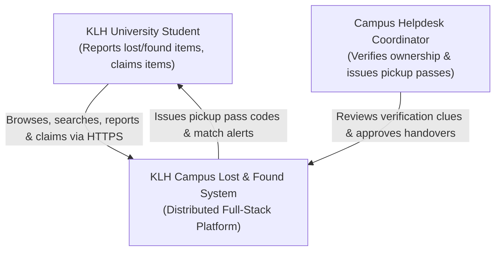
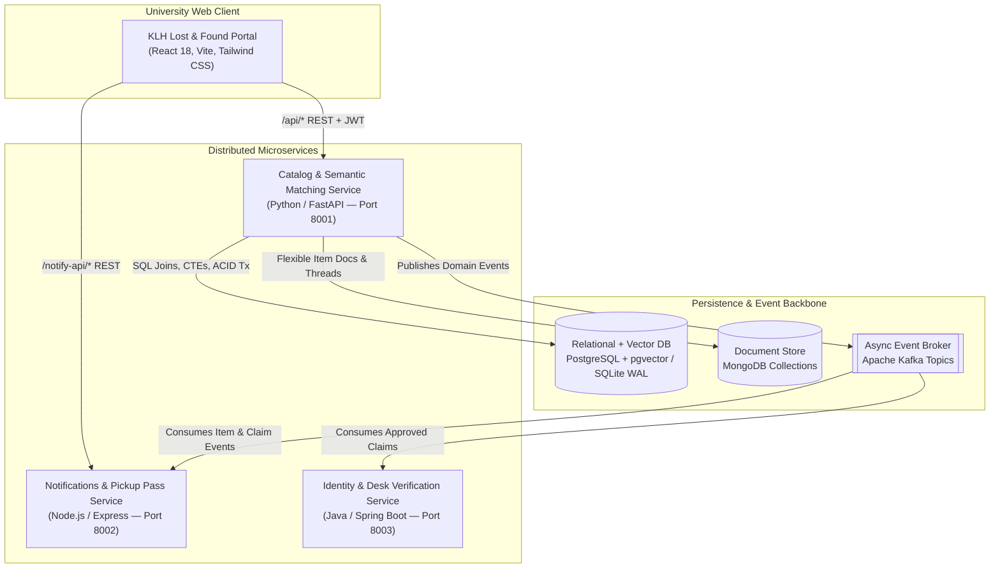
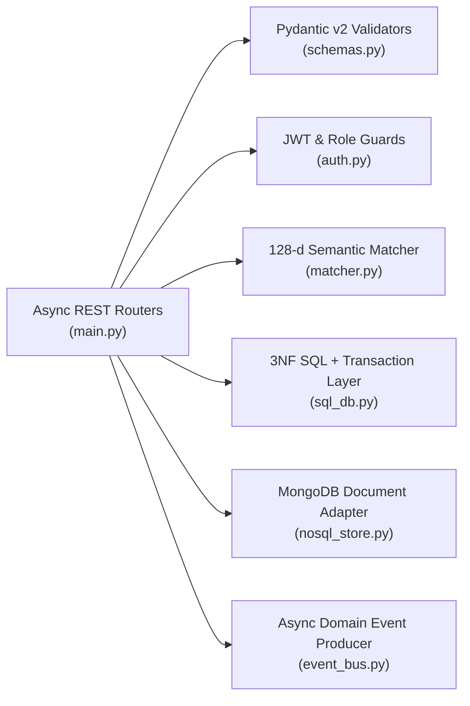

# KLH University Campus Lost & Found — C4 System Architecture & CO1–CO6 Mapping

## 1. Course Outcomes (CO1–CO6) Implementation Matrix

| Module | Requirement Summary | Project Implementation |
|---|---|---|
| **CO1** | Normalised relational schemas, optimised SQL (JOINs, CTEs, window functions, ACID transactions), live backend API replacing mock data | 3NF schema (`users`, `campus_locations`, `categories`, `items`, `item_matches`, `claims`, `item_status_history`) in `database/postgres_schema_pgvector.sql` and `services/catalog-matching-fastapi/sql_db.py`. Live CTEs + `RANK() OVER` / `ROW_NUMBER() OVER` window functions and `BEGIN IMMEDIATE ... COMMIT/ROLLBACK` ACID transactions in `main.py`. |
| **CO2** | Differentiate SQL & NoSQL data models; integrate SQL + MongoDB in the same backend; apply vector store (`pgvector` / cosine embeddings) for semantic search | Transactional entities stored in SQL; schema-flexible attributes, private handover clues, and verification event logs stored in `nosql_store.py` (`Motor`/MongoDB + local document collection engine). 128-dimensional semantic embeddings + cosine similarity matcher in `matcher.py` and `vector(128)` HNSW index in `postgres_schema_pgvector.sql`. |
| **CO3** | Production async FastAPI REST API with Pydantic validation, Dependency Injection, JWT authentication, OpenAPI docs; Flask & Django self-learning explorations | Async FastAPI service (`services/catalog-matching-fastapi/`) with Pydantic v2 models (`schemas.py`), `Depends` DI, PBKDF2 + JWT Bearer auth (`auth.py`), and `/docs` OpenAPI spec. Self-learning modules in `self-learning/flask-digest-api/` and `self-learning/django-campus-registry/`. |
| **CO4** | Node.js/Express and Spring Boot backend services; SOA & monolith-to-microservices thinking; .NET Core self-learning | Live Node.js/Express Campus Updates & Pickup Pass microservice (`services/claims-express-service/`), Spring Boot Campus Roll-No & Desk Verification service (`services/verification-springboot-service/`), and `.NET Core` Minimal API audit service (`self-learning/dotnet-audit-service/`). |
| **CO5** | Decompose into bounded-context microservices; inter-service communication via REST & asynchronous message brokers (Kafka) | Three bounded contexts communicating via REST and asynchronous partitioned topics (`campus.item.reported`, `campus.match.discovered`, `campus.claim.submitted`, `campus.claim.approved`, `campus.item.reunited`) via `event_bus.py` + Apache Kafka KRaft. |
| **CO6** | Containerise & deploy distributed full-stack system with Docker, C4 documentation, CI/CD pipeline, and live showcase | Multi-container `docker-compose.yml`, service `Dockerfile`s, GitHub Actions workflow `.github/workflows/ci-cd.yml`, C4 architecture diagrams below, and the cohesive KLH University web portal (`frontend/`). |

---

## 2. SQL vs. NoSQL Data Model Differentiation (CO2)

| Dimension | Relational SQL (`PostgreSQL` / `SQLite`) | Document NoSQL (`MongoDB` Collections) | Vector Store (`pgvector` / 128-d Cosine) |
|---|---|---|---|
| **Data Stored** | Users, Campus Locations, Categories, Lost/Found Items, Ownership Claims, Status Audit Ledger | Category-specific item attributes, private finder verification clues, claim review timelines | 128-dimensional L2-normalised item & search embeddings |
| **Schema Design** | Strict 3NF relational tables with foreign keys & check constraints | Flexible JSON/BSON documents varying per item category | Fixed-dimension dense float vectors (`vector(128)`) |
| **Consistency Model** | Strong ACID transactions (atomic claim approval + competing claim rejection + pickup code issuance) | Document-level atomic `$push` / `upsert` operations | Read-optimised similarity ranking |
| **Query Pattern** | Multi-table `JOIN`s, `WITH` CTEs, `RANK()` & `ROW_NUMBER()` window functions | Key-value / document lookups (`find_one`, `$in`, `$push`) | Cosine similarity (`1 - (embedding <=> query_vec)`) |

---

## 3. C4 Model System Documentation (CO6)

### Level 1 — System Context Diagram

### Level 2 — Container Diagram

### Level 3 — Component Diagram (Catalog & Matching FastAPI Service)

### Level 4 — Code / Bounded Context Decomposition (CO5)

1. **Catalog & Semantic Matching Context (`services/catalog-matching-fastapi/`)**: Owns lost/found item lifecycle, normalised campus locations/categories, 128-d description vectorization, pairwise similarity scoring, and transactional claim state transitions.
2. **Campus Updates & Pickup Pass Context (`services/claims-express-service/`)**: Subscribes to `campus.item.reported`, `campus.match.discovered`, `campus.claim.submitted`, `campus.claim.approved`, and `campus.item.reunited` to maintain per-student alert queues, campus reunion feed, and digital pickup passes.
3. **Identity & Verification Ledger Context (`services/verification-springboot-service/`)**: Validates KLH University roll number formats and records approved desk handovers from Kafka topics.
